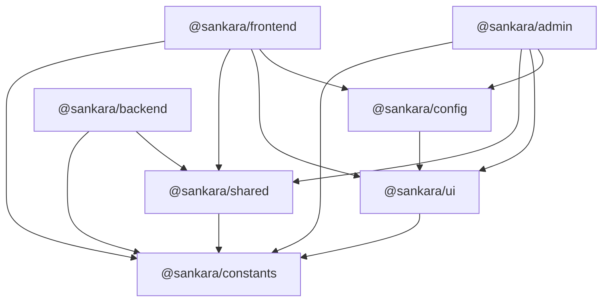

# Monorepo Structure & Package Boundaries

## 1. Monorepo Organization

The project uses npm workspaces to manage dependencies, isolate build boundaries, and share common code across applications.

```text
sri-sankara-production/
├── apps/
│   ├── frontend/         # Operational portal for daily production management
│   ├── admin/            # Central governance, staff directory, audit and config
│   └── backend/          # Central API, Mongoose models, and cron workers
├── packages/
│   ├── shared/           # Date formatters (IST), currency helpers, validation rules
│   ├── ui/               # CSS tokens, atomic classes, shared icons & primitives
│   ├── constants/        # Central roles, status enums, API paths, and outbox keys
│   └── config/           # Shared Tailwind preset, ESLint configurations
```

## 2. Dependency Graph & Isolation Rules



### Isolation Rules
1. **No Circular Dependencies**: Lower-level packages (`@sankara/constants`, `@sankara/shared`) must never depend on higher-level applications.
2. **Frontend Independence**: `frontend` and `admin` never import directly from each other; shared logic or UI components are extracted to `packages/`.
3. **Backend Exclusivity**: Backend models and database queries are completely decoupled from frontend code; communication is purely through JSON REST APIs.
