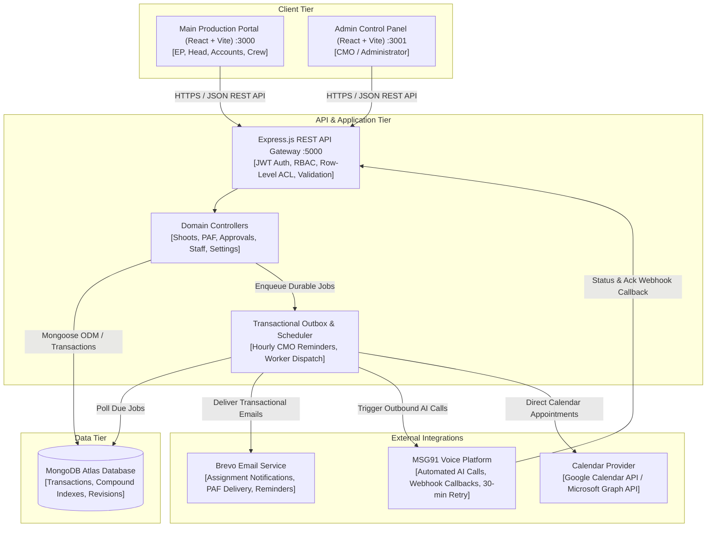

# System Architecture Specification

## 1. Architectural Overview

Sri Sankara TV Production Management System is designed as a distributed, service-oriented multi-tier web application built on modern JavaScript/Node.js technologies:

## 2. Key Architectural Tenets

### 2.1. Unidirectional Lifecycle
Production operations follow a strictly ordered flow:
1. **Executive Producer**: Proposes shoot requirements (Title, Dates, Venue, Equipment).
2. **Production Head**: Allocates day-specific crew/equipment and formulates the itemized PAF budget.
3. **Combined CMO Decision**: A single binding decision covers both schedule and budget.
4. **Automated Fan-Out**: Outbox workers publish to Accounts, email crew, queue voice calls, and write calendar events.
5. **Crew Acknowledgement**: Crew confirm assignments via mobile portal or voice prompt.

### 2.2. Zero Financial Exposure to Unauthorized Roles
The system enforces strict object-level and field-level access control on the backend:
- The `PAF` entity is accessible only to `production_head`, `cmo`, and `accounts` (accounts can view only after status becomes `approved`).
- Any attempt by `ep` or `crew` to access PAF endpoints, financial totals, unit rates, or line items yields HTTP `403 Forbidden` or redacted payloads.

### 2.3. Transactional Outbox Pattern
Third-party network calls (Brevo, MSG91, Calendar) are never performed synchronously inside the HTTP approval transaction. Doing so would cause timeouts, duplicate calls on retries, or partial failures. Instead:
- Approving a package commits the approval status and enqueues immutable job records into the `OutboxJob` collection within the same transaction.
- Background worker loops pick up due jobs, execute provider calls with idempotency keys, and update state (`pending` ➔ `sending` ➔ `delivered` or `retryable_failure`).
