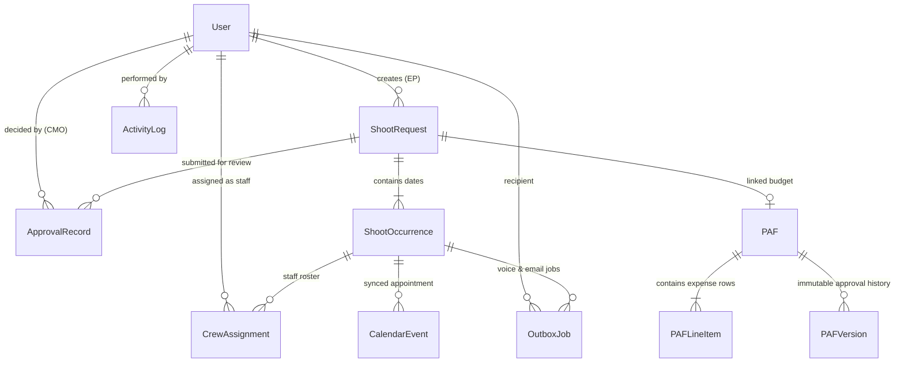

# MongoDB Database Architecture & Schema Specification

The Sri Sankara TV Production Management System utilizes **MongoDB Atlas** with **Mongoose ODM**. It enforces relational integrity through document references, schema validation, and atomic multi-document transactions.

---

## 1. Entity-Relationship Overview



---

## 2. Core Collections & Schema Definitions

### 2.1. `users` (Staff & System Accounts)
```javascript
{
  _id: ObjectId,
  name: { type: String, required: true },
  email: { type: String, required: true, unique: true, lowercase: true, index: true },
  password_hash: { type: String, required: true },
  role: { 
    type: String, 
    enum: ['cmo', 'production_head', 'ep', 'accounts', 'crew'],
    required: true,
    index: true
  },
  designation: { type: String }, // e.g. 'Senior Cameraman', 'Video Editor'
  team: { type: String },        // e.g. 'Camera', 'Audio', 'Post-Production', 'Transport'
  phone_e164: { type: String },  // Normalized E.164 (e.g. '+919840011010')
  voice_language: { type: String, enum: ['ta', 'en'], default: 'ta' },
  voice_opt_in: { type: Boolean, default: false },
  consent_timestamp: { type: Date },
  active: { type: Boolean, default: true, index: true },
  created_at: { type: Date, default: Date.now },
  updated_at: { type: Date, default: Date.now }
}
```

### 2.2. `shoot_requests` (Parent Production Series)
```javascript
{
  _id: ObjectId,
  series_code: { type: String, required: true, unique: true, index: true }, // e.g. 'SSTV-2026-0001'
  title: { type: String, required: true },
  client_guest: { type: String },
  category: { type: String, enum: ['studio', 'temple_ob', 'event', 'documentary'], default: 'studio' },
  ep_id: { type: ObjectId, ref: 'User', required: true, index: true },
  ep_name: { type: String },
  status: { 
    type: String, 
    enum: ['requested', 'changes_requested', 'pending_approval', 'approved', 'cancelled'],
    default: 'requested',
    index: true 
  },
  equipment_requirements: { type: String },
  crew_count_preferred: { type: Number, default: 4 },
  notes: { type: String },
  urgency: { type: String, enum: ['normal', 'urgent', 'priority'], default: 'normal' },
  paf_id: { type: ObjectId, ref: 'PAF', default: null },
  revision: { type: Number, default: 1 },
  last_submitted_at: { type: Date },
  approved_at: { type: Date },
  approved_by: { type: ObjectId, ref: 'User' },
  cancellation_reason: { type: String },
  created_at: { type: Date, default: Date.now },
  updated_at: { type: Date, default: Date.now }
}
```

### 2.3. `shoot_occurrences` (Day-Specific Occurrences)
```javascript
{
  _id: ObjectId,
  shoot_id: { type: ObjectId, ref: 'ShootRequest', required: true, index: true },
  series_code: { type: String, required: true },
  shoot_date: { type: String, required: true, index: true }, // 'YYYY-MM-DD'
  reporting_time: { type: String, required: true },          // 'HH:mm'
  rolling_time: { type: String, required: true },            // 'HH:mm'
  end_time: { type: String, required: true },                // 'HH:mm'
  is_overnight: { type: Boolean, default: false },
  start_at_utc: { type: Date, required: true, index: true },
  end_at_utc: { type: Date, required: true, index: true },
  venue: { type: String, required: true },
  venue_map_link: { type: String },
  status: { 
    type: String, 
    enum: ['requested', 'pending_approval', 'approved', 'cancelled'],
    default: 'requested' 
  },
  assignments: [{
    user_id: { type: ObjectId, ref: 'User', required: true },
    role_title: { type: String, required: true }, // 'Camera 1', 'Driver', etc.
    reporting_override: { type: String },
    response_state: { 
      type: String, 
      enum: ['pending', 'acknowledged', 'conflict_reported'], 
      default: 'pending' 
    },
    acknowledged_at: { type: Date },
    conflict_notes: { type: String }
  }]
}
```

### 2.4. `pafs` (Production Approval Forms)
```javascript
{
  _id: ObjectId,
  shoot_id: { type: ObjectId, ref: 'ShootRequest', required: true, unique: true },
  series_code: { type: String, required: true, index: true },
  show_name: { type: String, required: true },
  shoot_start: { type: String, required: true },
  shoot_end: { type: String, required: true },
  location: { type: String, required: true },
  episodes: { type: Number, default: 1 },
  equipment_type: { type: String, default: 'In-house' },
  notes: { type: String },
  items: [{
    particulars: { type: String, required: true },
    unit: { type: String, default: 'Days' },
    quantity: { type: Number, required: true, min: 0 },
    rate_paise: { type: Number, required: true, min: 0 }, // e.g. ₹100 = 10000 paise
    amount_paise: { type: Number, required: true, min: 0 },
    payment_mode: { type: String, enum: ['Cash', 'UPI', 'Bank Transfer', 'Company Voucher'], default: 'Cash' }
  }],
  estimated_total_paise: { type: Number, required: true, default: 0 },
  status: { 
    type: String, 
    enum: ['draft', 'pending_cmo', 'approved', 'changes_requested'], 
    default: 'draft',
    index: true 
  },
  created_by: { type: ObjectId, ref: 'User' },
  approved_by: { type: ObjectId, ref: 'User' },
  approved_at: { type: Date },
  snapshot_json: { type: Object } // Immutable post-approval audit snapshot
}
```

### 2.5. `outbox_jobs` (Durable Job Dispatch)
```javascript
{
  _id: ObjectId,
  idempotency_key: { type: String, required: true, unique: true, index: true },
  channel: { 
    type: String, 
    enum: ['brevo_email', 'msg91_voice', 'google_calendar', 'outlook_calendar'], 
    required: true,
    index: true 
  },
  event_type: { type: String, required: true }, // e.g. 'cmo_approval_required', 'shoot_assigned'
  recipient_id: { type: ObjectId, ref: 'User' },
  recipient_address: { type: String }, // Email or Phone E.164
  payload: { type: Object, required: true },
  state: { 
    type: String, 
    enum: ['pending', 'sending', 'delivered', 'retryable_failure', 'permanent_failure', 'cancelled'], 
    default: 'pending',
    index: true 
  },
  attempts: { type: Number, default: 0 },
  max_attempts: { type: Number, default: 2 },
  next_attempt_at: { type: Date, default: Date.now, index: true },
  provider_reference: { type: String }, // Remote message ID or call attempt ID
  last_error: { type: String },
  created_at: { type: Date, default: Date.now }
}
```

---

## 3. Financial Integrity & Decimal Safety
MongoDB stores currency amounts in **integer paise** (`1 INR = 100 paise`). This completely avoids floating point inaccuracies (e.g. `0.1 + 0.2 = 0.30000000000000004`):
- `rate_paise = Math.round(rate * 100)`
- `amount_paise = Math.round(quantity * rate_paise)`
- `estimated_total_paise = sum(amount_paise)`
- Display values are converted via `(paise / 100).toLocaleString('en-IN', { style: 'currency', currency: 'INR' })`.
