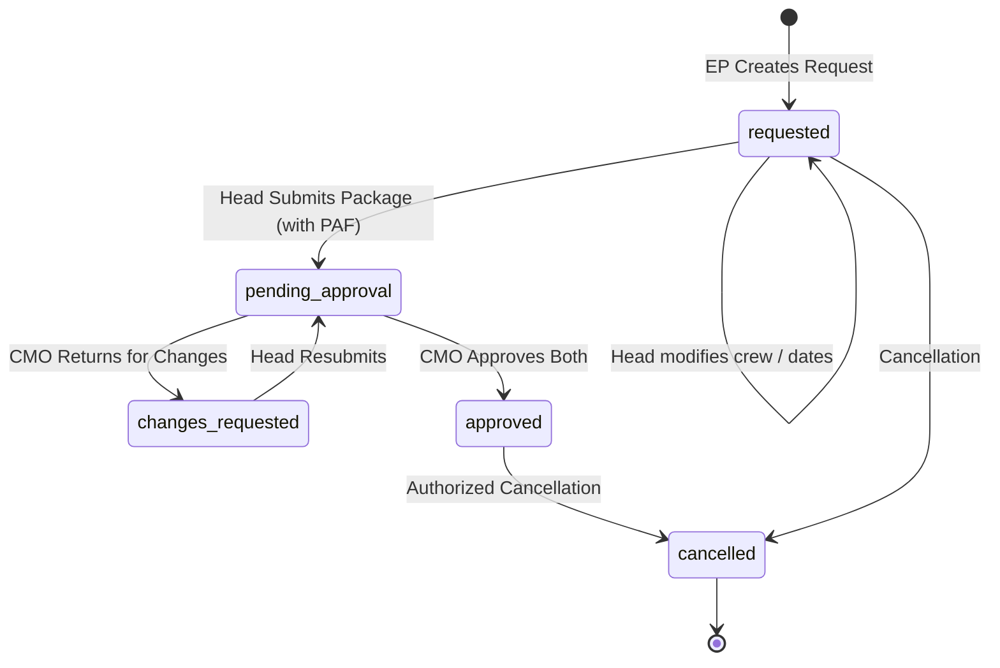

# Production Workflow Specification

This document details the complete end-to-end operational lifecycle of a production shoot in Sri Sankara TV.

---

## 1. Production State Machine

---

## 2. Operational Phases

### Phase 1: Request Initiation (Executive Producer)
- **Actor**: Executive Producer (`ep`).
- **Data Required**: Program Name, Client/Guest, Category (Studio, Temple OB, Event, Documentary), Occurrence Dates, Reporting Time, Rolling Time, Pack-up Time, Venue & Map URL, Equipment list, Preferred crew count.
- **Rules**: EPs cannot create or view PAF records. Dates must not be in the past unless overridden. Multi-day requests generate linked `shoot_occurrences`.

### Phase 2: Crew Scheduling & Conflict Detection (Production Head)
- **Actor**: Production Head (`production_head`).
- **Action**: Inspects requests, allocates staff (Camera, Tech, Sound, Assistant, Driver), assigns vehicles/equipment.
- **Conflict Algorithm**:
  For every candidate crew member:
  1. Retrieve all occurrences on the requested date.
  2. Compute effective time window: `[reporting_time - buffer, end_time + buffer]`.
  3. Detect overlaps against already scheduled occurrences (`approved` or `pending_approval`).
  4. Block submission if an unresolved overlap is detected.

### Phase 3: PAF Budget Formulation (Production Head)
- **Actor**: Production Head or CMO.
- **Action**: Itemize estimated expenses: particulars, unit, quantity, rate.
- **Rule**: Server enforces `amount = quantity × rate`. Grand total is calculated server-side.

### Phase 4: Combined Package Submission
- **Actor**: Production Head.
- **Validation Before Submission**:
  1. All occurrences must belong to the same series.
  2. All required crew slots must be filled.
  3. Zero overlapping crew conflicts.
  4. PAF budget complete and reconciled.
- **Result**: Atomically marks shoot occurrences and PAF as `pending_approval` / `pending_cmo`. Dispatches initial notification to CMO and starts hourly pending reminder scheduler.
